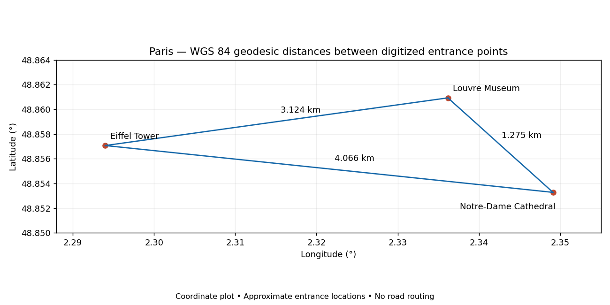
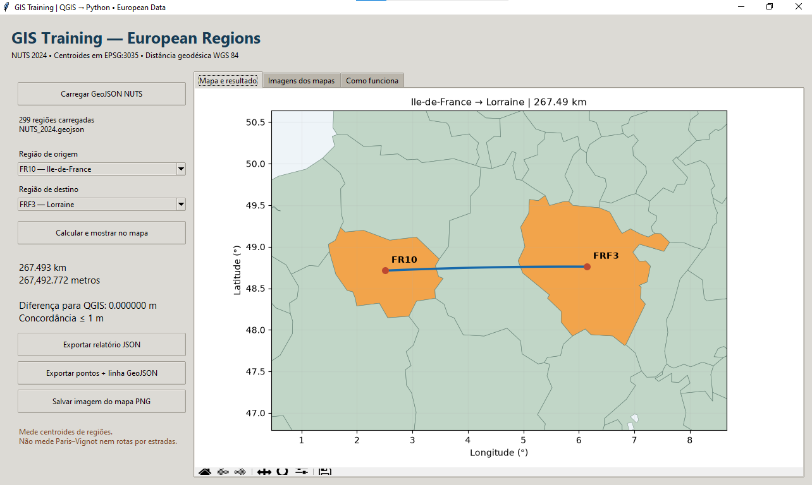
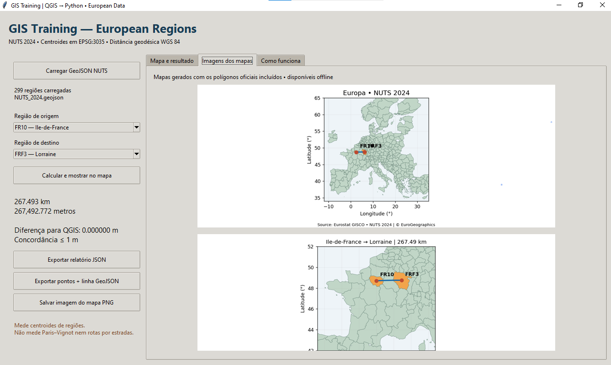
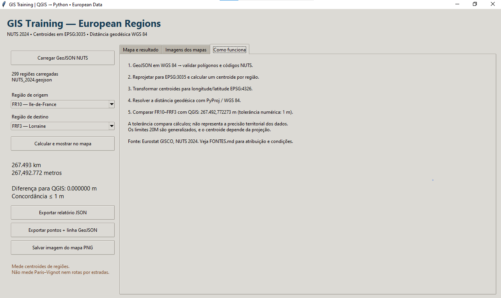

# GIS Distance Training

Hands-on GIS learning with **QGIS and Python**, using European regional polygons to calculate and compare distances between geometric centroids.

This is an educational project, separate from the official ERA Energy project. The current release is a **Python desktop application** with an English interface, run locally through PyCharm. Phase 3 adds a local FastAPI service and a desktop API comparison tab.

## Rio de Janeiro — QGIS → Python → FastAPI

The [Rio project](rio/README.md) now includes **four locations and six geodesic pairs**: Copacabana Palace, the Christ the Redeemer monument, the Sugarloaf summit, and the separately retained Cosme Velho train station (RIO04). It includes an English desktop dashboard, local FastAPI, pair selection, CSV/GeoJSON/PNG exports, and a shared-engine API comparison.

- Open `rio/` and run `RUN_DASHBOARD.cmd`, then `RUN_API.cmd` on Windows.
- Rio API documentation: http://127.0.0.1:8002/docs (Paris remains on port 8001).
- Tests from `rio/`: `python -m unittest discover -s tests -v`.
- **Status: cartographic references pending visual QGIS review.** Monument/summit points use mapped OSM features; access references remain approximate. No field-surveyed coordinates or Rio QGIS reference measurements are claimed. Images and the final LinkedIn post are planned after validation.

## Paris landmarks — QGIS → Python → FastAPI

The [Paris project](paris/README.md) includes the three manually digitized entrance points for Notre-Dame Cathedral, the Louvre Museum, and the Eiffel Tower, an English desktop dashboard, a local FastAPI service, and comparison with the recorded QGIS distance matrix.

- Open the `paris` folder and double-click `RUN_DASHBOARD.cmd` on Windows (Python 3.12 required).
- Start `RUN_API.cmd` in the same folder; Paris API documentation: http://127.0.0.1:8001/docs.
- Run the Paris tests from that folder: `python -m unittest -v`.

The three distances agree with the recorded QGIS values within 0.001 m. The points were manually digitized from a basemap; numerical agreement does not establish entrance-position accuracy. Desktop and API share a calculation engine.



The European regional-centroid application remains in the repository root; the instructions below apply to that application.

## Desktop application

The screenshots below document the earlier Phase 2 interface in Portuguese. The current Phase 3 dashboard, API descriptions, code messages, and generated maps are in English.



- Load the included 299 NUTS 2024 level 2 regions, or a compatible polygon GeoJSON.
- Select two regions and display their polygons, centroids, and geodesic connection.
- Compare FR10–FRF3 against the recorded QGIS reference.
- Export a JSON report, GeoJSON points and line, and a PNG map.
- Explore offline map images and the calculation workflow.
- Compare the current desktop result with a live FastAPI response in the **API comparison** tab.

<details>
<summary>Map gallery and methodology screenshots</summary>




</details>

## Run in PyCharm / Windows

Python **3.12** is recommended. Download and extract the repository, open its root folder in PyCharm, and select a Python virtual environment.

```powershell
py -3.12 -m venv .venv
.\.venv\Scripts\python.exe -m pip install -r requirements.txt
.\.venv\Scripts\python.exe main.py
```

Alternatively, with the environment active:

```bash
python -m pip install -r requirements.txt
python main.py
```

Tkinter is included with standard Windows Python installations when Tcl/Tk is enabled. Dependency installation requires internet; the included data and maps work offline afterwards. QGIS is not required to run the desktop app.

Portuguese instructions: [LEIA_ME.md](LEIA_ME.md).

## Phase 3: start FastAPI

In a second PyCharm terminal, use the same Python environment and repository root:

```bash
python -m uvicorn api:app --host 127.0.0.1 --port 8000
```

Keep that terminal running. Open http://127.0.0.1:8000/docs for the interactive API documentation.

| Endpoint | Purpose |
|---|---|
| `GET /health` | Service status and loaded region count |
| `GET /regions` | Available identifiers and region names |
| `POST /distance` | Calculate distance for the requested region pair |

In `/docs`, expand **POST /distance**, choose **Try it out**, and submit:

```json
{"origin": "FR10", "destination": "FRF3"}
```

Expected distance: approximately **267492.772273 m**. Unknown identifiers return HTTP 404; invalid requests or the same region return HTTP 422.

Start `main.py`, calculate a pair, then open **API comparison** and select **Compare API with current desktop result**. The app checks the distance, centroid coordinates, identifiers, CRS, ellipsoid, and method; for FR10–FRF3 it also shows the API difference from the recorded QGIS result.

The API always uses the bundled dataset. A custom desktop dataset may produce different results. This comparison checks HTTP integration and shared calculation consistency, not an independent geodetic method or territorial accuracy.

You can also check a running server without opening the desktop:

```bash
python verify_api.py
```

Stop the server with **Ctrl+C**. No hosting account, API key, or QGIS installation is needed. The server binds to localhost by default.

## Calculation and reference result

1. Read WGS 84 polygon coordinates from GeoJSON.
2. Transform polygons to **EPSG:3035 — ETRS89 / LAEA Europe**.
3. Calculate one geometric centroid per region.
4. Transform centroids to **EPSG:4326 — WGS 84**.
5. Solve the inverse geodesic problem with `pyproj.Geod`, using the WGS 84 ellipsoid.

| Region | NUTS ID | Centroid longitude | Centroid latitude |
|---|---|---:|---:|
| Île-de-France | FR10 | 2.5106953496118245 | 48.71303095314115 |
| Lorraine | FRF3 | 6.146890443692983 | 48.76078944599512 |

Recorded QGIS reference: **267492.77227324113 m**, approximately **267.49 km**. The desktop result agrees at the displayed precision. The numerical reference check is shown only for this pair. A separate GeographicLib calculation of these same coordinates also agreed at the reported precision; it is not a dependency or built-in app check.

### Interpretation and limitations

- This is the geodesic distance between the computed **regional centroids**, not a road route or minimum distance between polygon boundaries.
- The included boundaries are generalized at **1:20 million**. Centroids depend on boundary geometry and the projection used to compute them, and can fall outside polygons.
- Agreement across software checks numerical consistency; it does not establish positional accuracy or constitute field validation. The app's 1 m tolerance is a numerical comparison criterion.
- EPSG:3035 is chosen for this European exercise. Adapt the projection and assumptions before applying the workflow elsewhere.
- The exported GeoJSON has two points and a two-vertex connecting line. The desktop map uses intermediate geodesic points for display. When remeasuring in QGIS, use WGS 84 ellipsoidal measurement.

## Verification

```bash
python -m unittest -v
```

Twelve tests cover the calculation core and API contract: QGIS agreement, desktop/API coordinates, reversed endpoints, another region pair, health/list endpoints, missing and extra request fields, unknown codes, same-region rejection, invalid coordinates, and GeoJSON export.

## Files

| Path | Purpose |
|---|---|
| `main.py` | Tkinter interface and Matplotlib maps |
| `api.py` | FastAPI service and request/response models |
| `api_client.py` | Live HTTP comparison used by the desktop |
| `verify_api.py` | Command-line check against a running API |
| `test_api.py` | API contract and reference tests |
| `core.py` | Data validation, centroid calculation, geodesic distance, GeoJSON export |
| `data/NUTS_2024.geojson` | Included Eurostat GISCO NUTS 2024 level 2 data |
| `assets/` | Map images rendered from the included polygons |
| `docs/screenshots/` | Captures of the running desktop application |
| `exemplo_resultado.json` | Example calculation report |
| `test_core.py` | Calculation and validation tests |
| `SOURCES.md` | English data attribution, conditions, and technical sources |

## Data attribution

Source: **Eurostat GISCO — NUTS 2024**, level 2, 1:20 million, EPSG:4326. **© EuroGeographics** for administrative boundaries.

[Official dataset](https://gisco-services.ec.europa.eu/distribution/v2/nuts/geojson/NUTS_RG_20M_2024_4326_LEVL_2.geojson) · [GISCO catalogue](https://gisco-services.ec.europa.eu/distribution/v2/nuts/nuts-2024-files.html) · [Conditions and sources](SOURCES.md).

Third-party geographic data remain subject to their source conditions; inclusion here does not grant additional reuse rights.

## Next learning stages

- Phase 3 complete in code: local FastAPI and comparison workflow. Run it locally to inspect the English dashboard and API documentation.
- Practice point-to-point calculations for selected landmarks.
- Repeat with US and other geographic datasets, selecting appropriate projections and methods.
